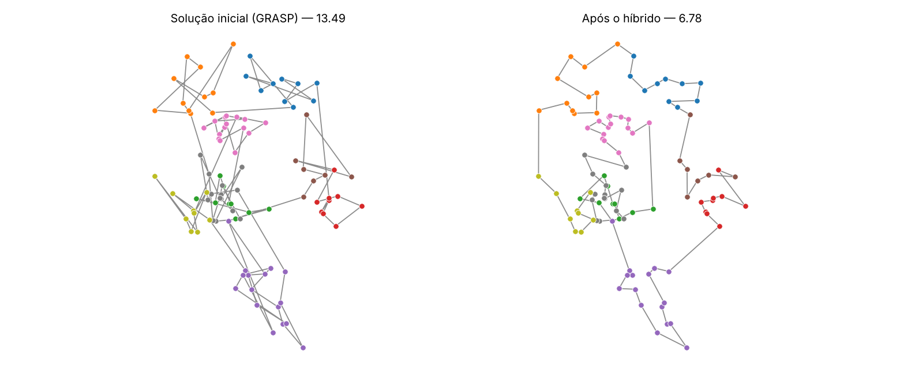

# CTSP com metaheurísticas híbridas

Solução do **Clustered Traveling Salesman Problem (CTSP)** com um algoritmo híbrido:
**GRASP** para gerar a população inicial e **VNS + Simulated Annealing + Algoritmo Genético** cooperando a cada iteração.

No CTSP as cidades estão divididas em clusters e a rota precisa visitar todas as cidades de um cluster
em sequência antes de passar para o próximo. O objetivo é minimizar a distância total do ciclo.



## Como funciona

| Etapa | O que faz |
|---|---|
| **Penalização** | Cada aresta entre clusters diferentes recebe `+M` na matriz de custo. Com `M > n · max(d)`, toda rota viável custa menos que qualquer inviável, então o ótimo do problema penalizado é o ótimo do CTSP. |
| **GRASP** | Construção gulosa-aleatória: a próxima cidade é sorteada na RCL (custo ≤ `c_min + α(c_max − c_min)`), com α sorteado em `{0.25, 0.5, 0.75}`. |
| **VNS** | Três vizinhanças em sequência — troca, inserção e 2-opt — até nenhuma melhorar. Avaliação por delta vetorizada (O(n²) por vizinhança). |
| **Simulated Annealing** | Movimentos aleatórios de inserção com delta O(1), critério de Metropolis e resfriamento geométrico. A temperatura inicial é calibrada pelos próprios dados. |
| **Algoritmo Genético** | Melhor metade da população como pais, crossover de 2 cortes (OX) e de 1 corte, mutação por troca adjacente e seleção elitista sem duplicatas. |
| **Híbrido** | A cada iteração: VNS e SA em cada solução, GA na população; as melhores soluções distintas seguem. Para em `Max_itters` ou após 30 iterações sem melhora. |

## Estrutura

```
ctsp/
├── utils.py           leitura, matriz penalizada, calc_of, viabilidade
├── grasp.py           soluções iniciais
├── neighborhoods.py   troca, inserção e 2-opt (avaliação por delta)
├── vns.py | sa.py | ga.py
├── hybrid.py          loop principal (run_hybrid)
└── plots.py           rota e convergência
instancias/            conjuntos de instâncias (sintéticas e baseadas na TSPLIB)
data/                  instâncias pequenas para testes rápidos
scripts/instances.py   conversor GTSPLIB → CSV, k-means sobre TSPLIB e gerador sintético
tests/test_ctsp.py     testes de correção (deltas vs. força bruta, big-M, viabilidade...)
main.py                experimento completo: várias runs por instância + estatísticas
CTSP_metaheuristicas.ipynb   passo a passo com gráficos
```

## Como rodar

```bash
pip install -r requirements.txt

# experimento: todas as instâncias de uma pasta, 10 runs por instância
python main.py --data instancias/sinteticas --runs 10 --itters 150

# só algumas instâncias
python main.py --data instancias/sinteticas --instances CTSP_50C4_1.csv CTSP_50C4_2.csv --runs 5

# testes
pip install pytest && python -m pytest -q
```

Saídas em `results/`:
- `runs.csv` — uma linha por (instância, run): viabilidade, OF, tempo, ordem dos clusters e a solução
- `summary.csv` — por instância: melhor, média, desvio padrão, mediana da OF, % de runs viáveis e tempo médio.
  Se a pasta de instâncias tiver um `bks.csv` (`Instance,BKS_literature`), inclui o gap % em relação à melhor solução conhecida.

Uso como biblioteca:

```python
from ctsp import read_tsp_file, build_cost_matrix, run_hybrid, calc_of

coords, cluster, distance = read_tsp_file('instancias/sinteticas/CTSP_50C4_1.csv')
cost, M = build_cost_matrix(distance, cluster)
solution, _, history = run_hybrid(cost, {'Max_itters': 50, 'M': M}, seed=0)
print(calc_of(solution, distance))
```

## Instâncias

Formato CSV: `X, Y, cluster, 0, 1, ..., n-1` (as colunas numéricas são a matriz de distâncias).
Os conjuntos disponíveis estão descritos em [`instancias/README.md`](instancias/README.md).

Para gerar novas:

```bash
# converter uma instância da GTSPLIB (.txt com GTSP_SET_SECTION)
python scripts/instances.py gtsp 25rat99.txt 25rat99.csv

# instância CTSP a partir de um .tsp da TSPLIB, com clusters por k-means
python scripts/instances.py tsplib eil101.tsp --k 50 --out 50eil101.csv

# instâncias sintéticas CTSP_<n>C<k>_<id>
python scripts/instances.py synthetic --n 200 --k 15 --quantity 10 --out data/
```

O conversor GTSPLIB arredonda as distâncias para o inteiro mais próximo (convenção EUC_2D da TSPLIB), que é como as
melhores soluções da literatura são calculadas — sem isso o gap não é comparável. Use `--no-round` para desligar.

## Reprodutibilidade

Cada run usa uma semente (`seed = nº da run`) aplicada em `random` e `numpy`, então o mesmo comando gera os mesmos resultados.
Como as metaheurísticas são estocásticas, os resultados devem ser lidos pela distribuição das runs (média, desvio, mediana),
não por uma execução isolada.
